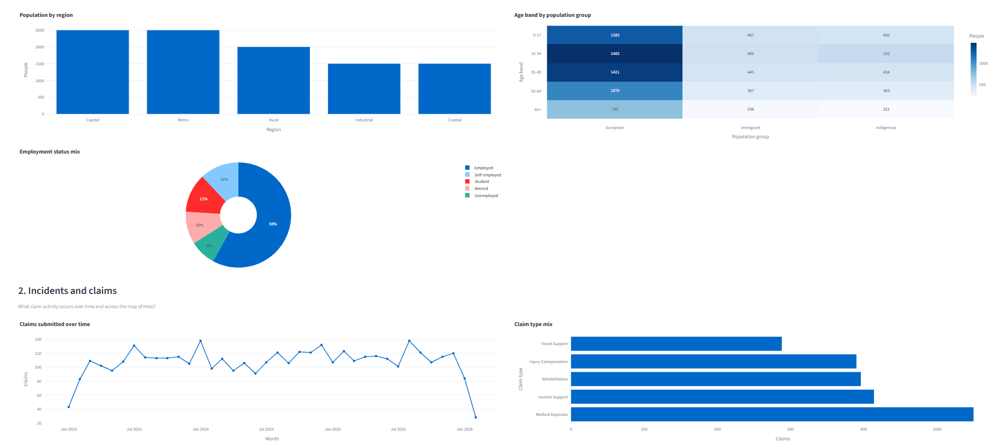
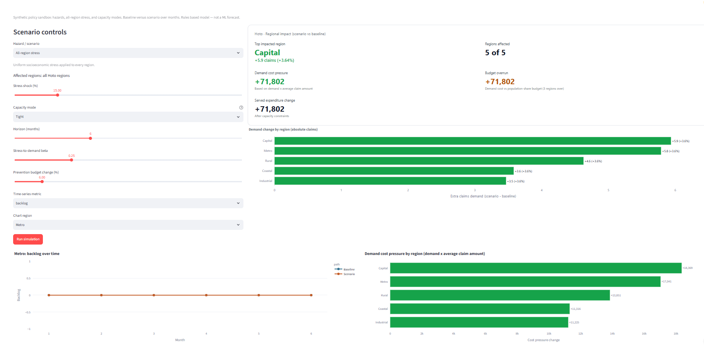

# Hoto — Synthetic Claims Risk Platform

Public sandbox for exploring synthetic claims risk scoring. Data and labels are
fully synthetic. Model scores are for triage demos and learning — not proof of
fraud or real claim decisions.

## Screenshots

### Hoto – Main Dashboard



### Simulation Lab



## App structure

1. **Home** — Hoto world narrative (people, claims, providers, approvals)
2. **Risk lab** — ensemble queue, threshold, provider risk charts
3. **Case explain** — claim timeline and contribution chart
4. **Model lab** — metrics and scenarios
5. **Simulation** — regional hazard and capacity sandbox

## Product features

1. Ensemble triage score (XGBoost + logistic + anomaly)
2. Transparent rule hits (velocity, duplicate signature, provider amount spike)
3. Provider-risk aggregation
4. Live threshold / top-N review capacity
5. Contribution force chart for individual claims

## Hoto Rural (independent MVP)

Regional microeconomic / freshwater simulation for Rural (~20% of island population).
Modules: Economics, Freshwater, Scenario Lab (Monte Carlo). Linked loop:
water → crops/livestock → manure/nutrients → profit/labour.

```bash
python -m hoto_rural
streamlit run app/rural_streamlit_app.py
```

## Project layout

```
Hoto/
  hoto/
  hoto_rural/
  app/streamlit_app.py
  app/rural_streamlit_app.py
  app.py
  hoto_pipeline.py
  requirements.txt
  data/
  data/rural/
  models/
```

## Local setup

```bash
python -m venv .venv
.venv\Scripts\activate
python -m pip install -r requirements.txt
```

### Train

```bash
python -m hoto
```

Demo scale:

```bash
python -m hoto --demo
```

### Run

```bash
streamlit run app/streamlit_app.py
```

If `data/` / `models/` are missing, the app builds a demo-scale world on first boot.

## Deploy (Streamlit Community Cloud)

1. Main file path: `app/streamlit_app.py`
2. App URL: `hoto-sims.streamlit.app`

## Inference API

```python
from hoto.infer import load_claim_models, score_claims
import pandas as pd

models = load_claim_models()
features = pd.read_csv("data/hoto_claim_features.csv")
metadata = pd.read_csv("data/hoto_claim_metadata.csv")
scored = score_claims(features, models=models, claim_metadata=metadata)
```

## Design notes

- Sensitive demographics stay out of model features.
- Grouped train/test splits reduce person/claim leakage.
- Prefer review-capacity and average precision over a hard 0.5 threshold.
- Labels come from injected scenarios (S001–S004), not real fraud cases.
